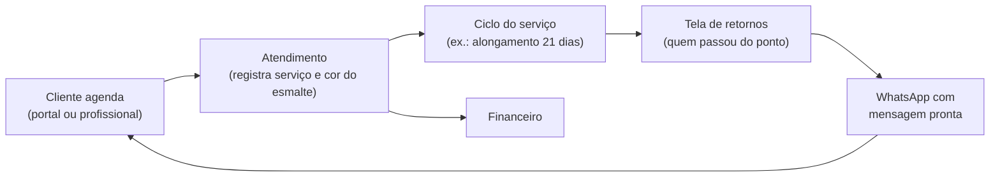
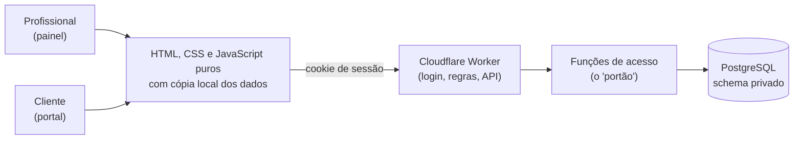

# Agenda para nail designer

**Sistema de gestão para uma nail designer autônoma: agenda, ficha das clientes, retornos de manutenção, mensagens de WhatsApp, financeiro e um portal onde a cliente agenda sozinha.**

Feito para uma profissional real, que trabalha sozinha e usa o sistema pelo celular entre um atendimento e outro.

> Este repositório é só a **apresentação** do projeto. O código é privado (veja o fim da página).

---

## O ciclo que o sistema acompanha

---

## O que faz

- **Agenda** com expediente por dia, almoço, folgas, bloqueios e visão de mês. Choque de horário é barrado no painel e no servidor.
- **Ficha da cliente** com o histórico de atendimentos. Cada atendimento guarda a cor do esmalte usada, como registro visual do trabalho.
- **Retornos de manutenção:** cada serviço tem um ciclo. A tela cruza a última visita com esse ciclo, mostra quem passou do ponto, quanto isso representa em receita e abre o WhatsApp com a mensagem pronta, uma cliente por vez.
- **Mensagens** com modelos e variáveis que se preenchem sozinhas (nome, serviço, data e horário), enviadas por link do WhatsApp, sem API paga.
- **Financeiro:** faturamento, despesas, gráficos por período, horários de pico e melhores clientes.
- **Portal da cliente:** cadastro com telefone e senha, agendamento com regras de antecedência e prazo de cancelamento, fila de solicitações para a profissional confirmar e contagem para a próxima manutenção.
- Tema claro e escuro, navegação inferior no celular e alvos de toque grandes.

---

## Arquitetura e segurança

- **Login próprio:** senhas com PBKDF2-SHA256 (100 mil iterações), sessão em cookie HttpOnly, comparação em tempo constante, bloqueio após erros seguidos e limite de tentativas por minuto.
- **Banco no modelo "portão":** as tabelas ficam num schema privado e só são alcançadas por funções específicas, sem usar a chave de serviço.
- **83 testes automatizados** (regras da agenda, armazenamento, API, servidor e integração com o banco). A publicação só acontece se todos passarem.

---

## O que eu fiz

Projeto de ponta a ponta: levantamento com a profissional (como ela trabalha, o que importa e o que fica fora), desenho das telas para o celular, regras da agenda e do ciclo de manutenção, API com login seguro, modelagem do banco, testes automatizados e publicação.

---

## Sobre o código

O código é **privado por estar em uso por uma cliente real**. Mostro a arquitetura e trechos em entrevista.

Contato: [LinkedIn](https://www.linkedin.com/in/neemiasjls/)
